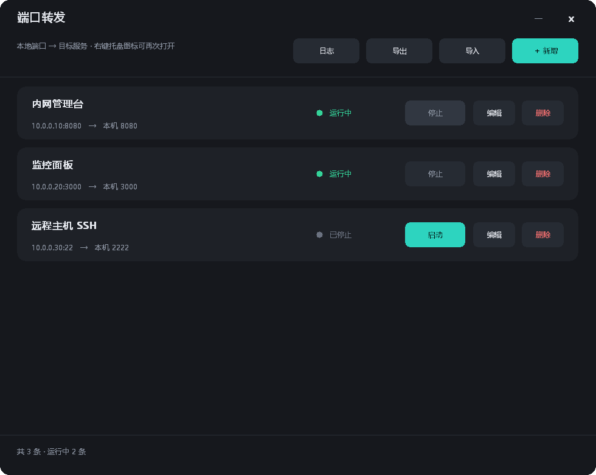
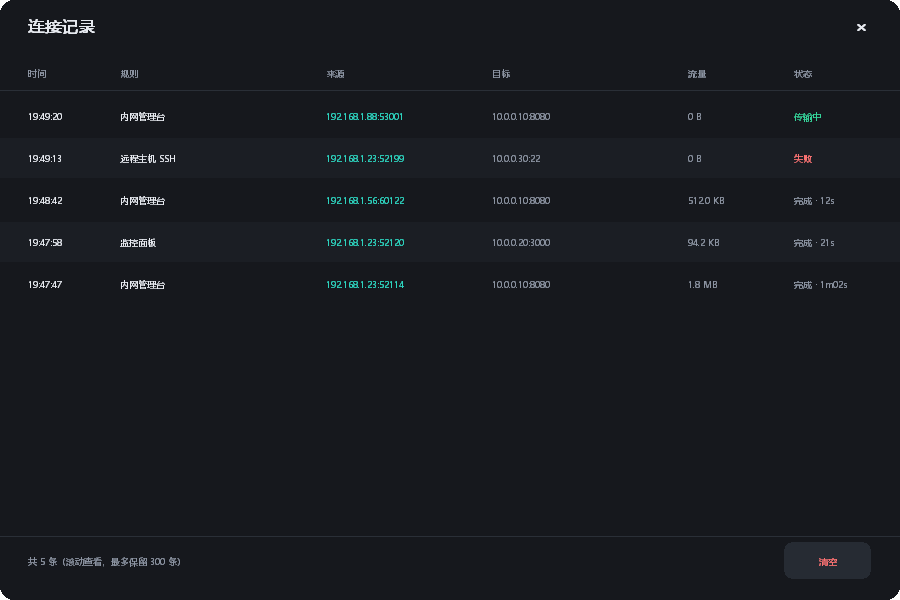

# PortFwd

A tiny Windows tray app for **TCP port forwarding**. It exposes a service that is only reachable from a specific network segment on a port of your own machine, so colleagues can open `http://your-ip:port` without a VPN account.

> Full manual: **[docs/USAGE.md](docs/USAGE.md)** · 中文文档: **[README.zh-CN.md](README.zh-CN.md)** / **[docs/使用说明.md](docs/使用说明.md)**



## Features

- **Single 2.5 MB exe**, no installer, no runtime, no third-party Go modules. Pure Go + Win32.
- **Chinese / English UI** — tray right-click *Language* offers Follow-system / 中文 / English; the choice is saved and reused on the next start (default: follow the system language).
- **Lives in the tray** — right-click for *Open panel / Start all / Stop all / Open log / UI scale / Install as service / Quit*. Click or double-click opens the panel and forces it to the foreground.
- **Editable rules** — add, edit, start/stop, delete. Each rule remembers its last state across restarts.
- **Connection log** — see who connected: time, rule, source `IP:port`, target, bytes transferred, duration or failure reason. Keeps the latest 300 entries in memory; one-click clear.
- **Import / export** rules as JSON.
- **Dark, borderless UI** drawn by hand (no GTK/Qt/Electron), rounded corners, custom title bar, 150 ms hover fades.
- **High-DPI aware** — Per-Monitor DPI V2, so text renders natively at 150% instead of being bitmap-stretched; an extra 90%-150% UI scale is available from the tray.
- **Optional Windows service** — `--install` keeps forwarding alive without a logged-in session; the panel then only edits rules.
- **Zero telemetry** — it never makes an outbound request. Rules live in `%APPDATA%\PortFwd\config.json`.



## Quick start

1. Run `PortFwd.exe`. The tray icon appears and the panel opens.
2. Click **New**, fill in *target host*, *target port*, *local port*, save. It starts listening immediately.
3. Allow the port in Windows Firewall (admin PowerShell):

   ```powershell
   New-NetFirewallRule -DisplayName "PortFwd-8080" -Direction Inbound -Protocol TCP `
     -LocalPort 8080 -Action Allow -Profile Any -RemoteAddress 10.0.0.0/24
   ```

4. Give your colleague `http://<your-ip>:8080`.

Closing the panel only hides it to the tray — forwarding keeps running. Only **Quit** stops everything.

## Download

Grab `PortFwd.exe` from the [latest release](../../releases/latest). Windows 10/11 x64, no dependencies.

## Build from source

Requires Go 1.22+, no CGO, no external modules.

```bash
# 1) icon (required only if you change the artwork)
go run ./tools/icongen icons/icon.ico

# 2) embed the icon into the exe resources (repo already ships the .syso)
GOPATH=/tmp/go go install github.com/akavel/rsrc@v0.10.2
/tmp/go/bin/rsrc -ico icons/icon.ico -arch amd64 -o rsrc_windows_amd64.syso

# 3) build
GOOS=windows GOARCH=amd64 CGO_ENABLED=0 \
  go build -trimpath -ldflags "-s -w -H windowsgui" -o PortFwd.exe .
```

## Command line

| Flag | Purpose |
|---|---|
| `--tray` / `--startup` | Start hidden in the tray (use this for autostart) |
| `--service` | Called by the service control manager |
| `--install` | Register + start as an auto-start service (admin) |
| `--uninstall` | Stop + delete the service (admin) |
| `--check` | Headless self-check: start all rules, write the result to `%TEMP%\portfwd-check.txt` |
| `--dump` | Dump the current config to `%TEMP%\portfwd-dump.json` |
| `--selftest` | Start a throwaway forward, make one real connection, dump the event |
| `--shot <file.bmp>` | Render the panel to a bitmap (UI regression) |
| `--shot-log <file.bmp>` | Render the connection log to a bitmap |

## Layout

| File | Role |
|---|---|
| `main.go` | Entry point, tray, panel painting/interaction, add-edit dialog, import/export |
| `win.go` | Thin Win32 bindings (user32 / gdi32 / shell32 / comdlg32) |
| `engine.go` | Forwards engine + connection events |
| `config.go` | Config struct and JSON I/O |
| `logwin.go` | Connection log window |
| `dpi.go` | High-DPI: DPI detection, logical→physical mapping |
| `lang.go` | String tables (zh/en) and system-language detection |
| `anim.go` | Hover transition animation |
| `service.go` | Windows service mode (install / remove / run) |
| `log.go` | Persistent log with rotation |
| `shot.go` | Off-screen rendering and self-tests |
| `tools/icongen` | Multi-size ICO generator (stdlib only) |
| `tools/bmp2png` | BMP → PNG converter used for the screenshots |
| `rsrc_windows_amd64.syso` | Icon resources, so the exe shows an icon in Explorer/taskbar |

## Limitations

- **No authentication.** The listening socket accepts anyone who can reach it; the security boundary is your firewall and network segment, not PortFwd.
- **TCP only.** No UDP.
- **Raw TCP forwarding** — no HTTP rewriting. If the target page hardcodes absolute URLs, pages may open but data may not load; use a reverse proxy in that case.
- Windows only (Win32 API).
