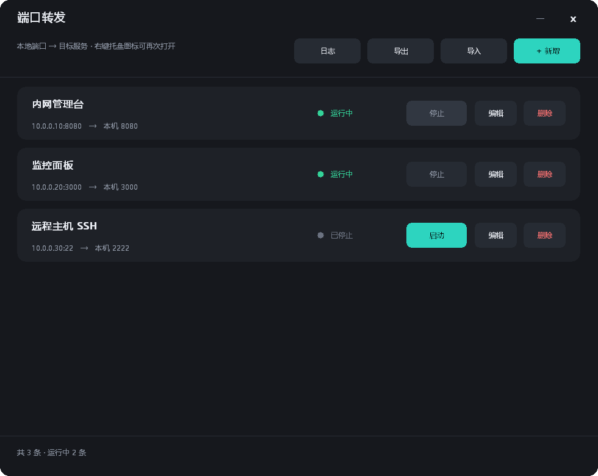
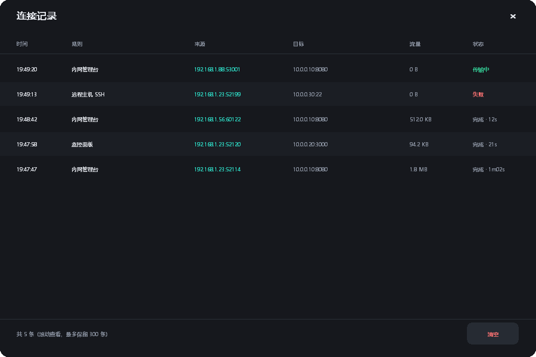

# PortFwd

Windows 托盘版 **TCP 端口转发**小工具。把「只有特定网段能访问的服务」搬到你本机的端口上，同事用 `http://你的IP:端口` 就能打开，不用给他开 VPN。

> 完整操作手册（防火墙、常见问题、截图）：**[docs/使用说明.md](docs/使用说明.md)** · English: **[README.md](README.md)** / **[docs/USAGE.md](docs/USAGE.md)**



## 特点

- **单文件 2.5 MB**，免安装、无运行时依赖、无第三方 Go 模块。纯 Go + Win32 自绘。
- **托盘常驻**：右键「打开面板 / 全部启动 / 全部停止 / 打开日志 / 界面缩放 / 安装为后台服务 / 退出」，单击或双击图标开面板（会强行置前）。
- **规则可编辑**：新增、编辑、启停、删除；每条规则记住上次状态，重启程序自动恢复。
- **连接记录**：能看到谁在什么时候连进来的——时间、规则、来源 `IP:端口`、目标、流量、耗时或失败原因，最多留 300 条，可一键清空。
- **导入导出**：规则存成 JSON，方便多机迁移或备份。
- **深色无边框界面**：手绘 UI（不用 GTK/Qt/Electron），圆角、自绘标题栏，悬停有 150ms 渐变过渡。
- **高分屏友好**：Per-Monitor DPI V2 感知，150% 缩放下字体原生渲染（不再被系统拉伸发糊）；托盘可再选 90%~150% 界面缩放。
- **可装成 Windows 服务**：`--install` 后开机即跑、不依赖登录，面板只负责编辑规则。
- **零联网**：程序不发任何外连请求；规则只存在 `%APPDATA%\PortFwd\config.json`。



## 快速上手

1. 双击 `PortFwd.exe`，托盘出现图标，面板自动打开。
2. 点「＋ 新增」，填 **目标地址 / 目标端口 / 本地端口**，保存后立即开始监听。
3. 管理员 PowerShell 放行防火墙：

   ```powershell
   New-NetFirewallRule -DisplayName "PortFwd-8080" -Direction Inbound -Protocol TCP `
     -LocalPort 8080 -Action Allow -Profile Any -RemoteAddress 10.0.0.0/24
   ```

4. 把 `http://<你的IP>:8080` 给同事。

关闭面板只是收进托盘，转发继续跑；只有「退出」才停止全部转发。

## 下载

到 [最新 Release](../../releases/latest) 下载 `PortFwd.exe`。Windows 10/11 x64，无需安装任何依赖。

## 从源码构建

需要 Go 1.22+，无 CGO、无外部模块。

```bash
# 1) 生成图标（改了图案才需要重跑）
go run ./tools/icongen icons/icon.ico

# 2) 把图标嵌进 exe 资源（仓库里已带 .syso）
GOPATH=/tmp/go go install github.com/akavel/rsrc@v0.10.2
/tmp/go/bin/rsrc -ico icons/icon.ico -arch amd64 -o rsrc_windows_amd64.syso

# 3) 编译
GOOS=windows GOARCH=amd64 CGO_ENABLED=0 \
  go build -trimpath -ldflags "-s -w -H windowsgui" -o PortFwd.exe .
```

## 命令行参数

| 参数 | 作用 |
|---|---|
| `--tray` / `--startup` | 启动后直接进托盘（开机自启用这个） |
| `--service` | 由服务控制管理器调用 |
| `--install` | 注册为自启服务并启动（管理员） |
| `--uninstall` | 停止并删除服务（管理员） |
| `--check` | 无界面自检：启动全部规则，结果写到 `%TEMP%\portfwd-check.txt` |
| `--dump` | 把当前配置导出到 `%TEMP%\portfwd-dump.json` |
| `--selftest` | 起一条临时转发并真连一次，导出连接事件 |
| `--shot <文件.bmp>` | 渲染面板截图 |
| `--shot-log <文件.bmp>` | 渲染连接记录截图 |

## 代码结构

| 文件 | 作用 |
|---|---|
| `main.go` | 入口、托盘、面板绘制与交互、新增/编辑对话框、导入导出 |
| `win.go` | Win32 薄封装（user32 / gdi32 / shell32 / comdlg32） |
| `engine.go` | 转发引擎 + 连接事件 |
| `config.go` | 配置结构与 JSON 读写 |
| `logwin.go` | 连接记录窗口 |
| `dpi.go` | 高分屏：DPI 检测、逻辑→物理坐标映射 |
| `anim.go` | 悬停过渡动画 |
| `service.go` | Windows 服务模式（安装 / 卸载 / 运行） |
| `log.go` | 常驻日志（滚动裁剪） |
| `shot.go` | 离屏渲染与自检 |
| `tools/icongen` | 多尺寸 ICO 生成（纯标准库） |
| `tools/bmp2png` | BMP→PNG（用于生成文档截图） |
| `rsrc_windows_amd64.syso` | 图标资源，让 exe 在资源管理器/任务栏显示图标 |

## 局限

- **没有身份认证**。监听口对所有能连到你机器的人开放，安全边界靠防火墙和网段，不靠 PortFwd。
- **仅 TCP**，不支持 UDP。
- **裸 TCP 转发**，不改写 HTTP。目标页面若硬编码绝对地址，可能出现「页面能开、数据不加载」，这种情况请用反向代理。
- 仅 Windows（Win32 API）。
