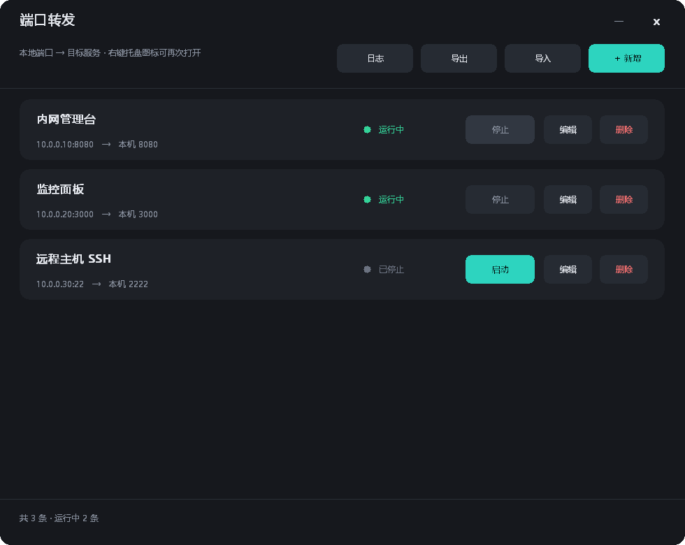
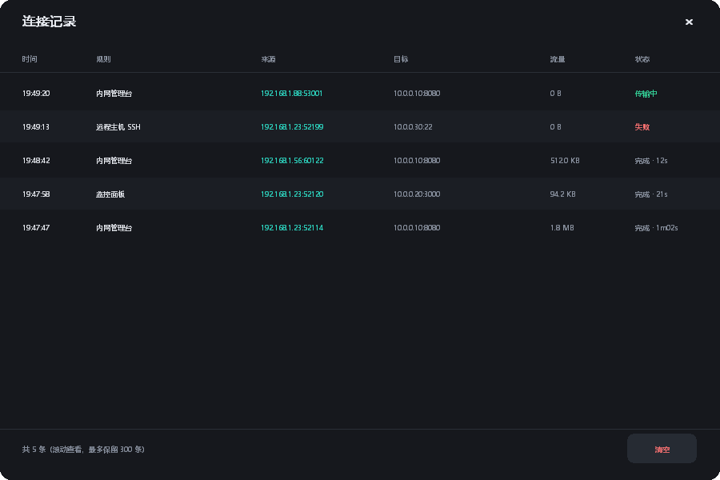

# PortFwd — User Manual

A small Windows tray utility that maps a service reachable only from a certain network segment onto a port on your own machine, so other people can open `http://your-ip:port`.

Typical use cases:

- You can reach an admin console from the office LAN / VPN but your colleague cannot → forward it on your machine and hand him the URL.
- The target only allows whitelisted source IPs, and you happen to be on that list.
- You don't want to issue a VPN account just to let someone look at one page.

**What it is not:**

- There is **no authentication**. The listening port accepts anyone who can reach it. Your firewall and network layout are the security boundary, not PortFwd.
- It forwards raw TCP only; it does not rewrite HTTP. See the FAQ about pages that open but never finish loading.

---

## 1. The window



| Area | What it does |
|---|---|
| Title bar | App name on the left; `—` minimize, `×` close (closing hides to tray, it does **not** quit). Drag the empty area to move the window |
| Toolbar | Hint text on the left; `Log` `Export` `Import` `＋ New` on the right |
| List | One card per rule: name, `target:port → local port`, status dot, `Start/Stop` `Edit` `Delete` |
| Footer | Totals, plus the reason of the last failure |

Status dot: green `running`, grey `stopped`, red `failed` (the reason appears in the footer);
when the service takes over, rules read `service-managed`.

Interaction details:

- Hovering a button, a card, or the title-bar `—` `×` fades the background in over ~150 ms and fades out on leave.
- Mouse wheel scrolls the list when there are more rules than fit.
- If `Start` fails (port already taken, etc.) you get a dialog with the actual error instead of silence.

---

## 2. First forward in five steps

### 2.1 Launch

Double-click `PortFwd.exe`. The tray icon appears and the panel opens. On first run the list is empty.

### 2.2 Click "New"

Four fields:

| Field | What to put | Example |
|---|---|---|
| Name | Anything you recognise; leave empty to auto-fill `host:port` | `Admin console` |
| Target host | IP or hostname of the service **as reachable from your machine** | `10.0.0.10` |
| Target port | Port the service listens on | `8080` |
| Local port | The port you expose to others; must be free on your machine | `8080` |

Click **Save**. Forwarding starts immediately and the dot turns green.

> The local port must be unique across rules; a duplicate is rejected with a message.

### 2.3 Allow it through Windows Firewall (usually the missing step)

The app listens on `0.0.0.0:<local port>`, but **Windows Firewall blocks inbound by default**, so nobody can connect until you add a rule. In an elevated PowerShell:

```powershell
New-NetFirewallRule -DisplayName "PortFwd-8080" -Direction Inbound -Protocol TCP `
  -LocalPort 8080 -Action Allow -Profile Any -RemoteAddress 192.168.1.0/24
```

`-RemoteAddress` decides **who may connect** — keep it as narrow as practical:

| Scenario | Suggested scope |
|---|---|
| Only people on your office subnet | e.g. `10.0.0.0/24` |
| Several corporate segments | `10.0.0.0/8` |
| Local testing only | `127.0.0.1` |

Takes effect immediately; no restart needed.

### 2.4 Get your IP and hand over the URL

```powershell
Get-NetIPAddress -AddressFamily IPv4 | Where-Object { $_.IPAddress -notlike "127.*" } |
  Select-Object IPAddress, InterfaceAlias
```

Pick the adapter your colleague can reach and send `http://<ip>:<local port>`.

### 2.5 Verify locally first

```powershell
curl.exe -s -o NUL -w "%{http_code}\n" http://127.0.0.1:8080/
```

`200` means the tunnel itself works. If your colleague still cannot open it, the remaining suspects are the firewall rule and the network path.

---

## 3. Managing rules

| Action | How |
|---|---|
| Start / stop one | `Start` / `Stop` on the card. State is persisted and restored on next launch |
| Edit | `Edit`; saving stops the old listener and restarts with the new parameters |
| Delete | `Delete`; stops and removes immediately (no confirmation) |
| All at once | Tray menu → `Start all` / `Stop all` |
| Scroll | With more than 6 rules, use the mouse wheel; the footer shows `page 1/N` |

---

## 4. Connection log — who is using it



Open with `Log` in the toolbar. Each row is **one TCP connection**:

| Column | Meaning |
|---|---|
| Time | When the connection was accepted |
| Rule | Which rule it matched |
| Source | The peer's `IP:port` — this is "who came in" |
| Target | The upstream service actually dialled |
| Bytes | Bidirectional total, in human units |
| Status | `transferring` / `done · duration` / `failed` (reason in footer) |

Notes:

- Keeps the latest **300** entries, dropping the oldest.
- **In memory only** — cleared when the app exits. `Clear` wipes it manually.
- The window refreshes once per second; new connections appear at the top.

---

## 5. Import / export

- `Export` writes all rules to a JSON file you choose.
- `Import` **replaces** the whole set (not a merge) and starts the rules whose `enabled` is true.

Example (addresses are placeholders):

```json
{
  "items": [
    {
      "id": "f1",
      "name": "Admin console",
      "target_host": "10.0.0.10",
      "target_port": 8080,
      "local_port": 8080,
      "enabled": true
    }
  ]
}
```

`enabled` is the last running state; an empty `id` is filled in automatically on import.

---

## 6. Tray and autostart

Tray context menu:

```
Open panel
──────
Start all
Stop all
──────
Open log
UI scale ▸  90% / 100% / 115% / 130% / 150%
Install as service  (shows "Uninstall service" once installed)
──────
Quit
```

- **Click or double-click** the icon to open the panel (it is forced to the foreground too).
- **`×` / close** hides the panel; forwarding keeps running.
- **Quit** stops all forwards and terminates the process.

Autostart (starts hidden in the tray):

```powershell
$exe = "C:\Apps\PortFwd\PortFwd.exe"
Register-ScheduledTask -TaskName "PortFwd" `
  -Action (New-ScheduledTaskAction -Execute $exe -Argument "--tray") `
  -Trigger (New-ScheduledTaskTrigger -AtLogOn -User "$env:USERDOMAIN\$env:USERNAME") `
  -Settings (New-ScheduledTaskSettingsSet -ExecutionTimeLimit ([TimeSpan]::Zero) -MultipleInstances IgnoreNew) `
  -Force
```

---

## 7. Where the config lives

```
%APPDATA%\PortFwd\config.json
```

i.e. `C:\Users\<you>\AppData\Roaming\PortFwd\config.json`. Delete it to reset.

---

## 7b. Logs (for troubleshooting)

```
%APPDATA%\PortFwd\portfwd.log
```

Tray right-click → **Open log** opens it directly. Appended on every run: startup args, loaded rules, tray registration result, each forward start/stop/failure, and every connection (source, target, bytes, duration).

```
[conn] open rule="Admin console" from=192.168.1.23:52114 to=10.0.0.10:8080
[conn] close from=192.168.1.23:52114 to=10.0.0.10:8080 bytes=18432 dur=1.2s
```

Rotation: the file is renamed to `portfwd.log.1` once it exceeds **2 MB** (one backup kept).

> The log contains real internal IPs and ports — sanitise it before sharing.

## 7c. High-DPI and UI scale

The app is **Per-Monitor DPI V2** aware: the UI is laid out in logical units and scaled to physical
pixels using the monitor's DPI, so text is rendered natively instead of being bitmap-stretched by Windows.

Buttons, list cards and the title-bar close glyph fade their background over ~150 ms when hovered
(and fade back on `WM_MOUSELEAVE`), instead of snapping.

Tray right-click → **界面缩放 (UI scale)** offers `90% / 100% / 115% / 130% / 150%` on top of the system
DPI. It is persisted as `ui_scale` in the config file:

```json
{
  "items": [ ... ],
  "ui_scale": 1.15
}
```

## 7d. Running as a Windows service (optional)

By default PortFwd is a per-user tray process: it starts at logon and stops when you quit.
To keep forwarding **without any logged-in session**, install it as a service.

Tray right-click → **安装为后台服务** (needs admin, UAC prompt). Afterwards:

| What | Detail |
|---|---|
| Service | `PortFwd`, start type Automatic, visible in `services.msc` |
| Who forwards | The service (LocalSystem), so closing the panel changes nothing |
| Panel role | Edit-only; the status column reads `服务托管` (service-managed). Saving a rule makes the service reload within ~2 s |
| Config | Moves to `%ProgramData%\PortFwd\config.json` (migrated automatically on first install) |
| Log | `%ProgramData%\PortFwd\portfwd.log` |

Remove it with tray right-click → **卸载后台服务**, or `PortFwd.exe --uninstall` as admin.
You go back to tray-process mode; the config stays in `ProgramData` (copy it back to `%APPDATA%` if you want).

CLI equivalents:

```
PortFwd.exe --install      # register + start (admin)
PortFwd.exe --uninstall    # stop + delete (admin)
```

> In service mode there is **no tray icon** (the service runs in session 0), so start the panel
> from a shortcut when you want to edit rules.

## 8. Command line


| Flag | Purpose |
|---|---|
| `--tray` / `--startup` | Start hidden in the tray |
| `--service` | Called by the service control manager (do not run manually) |
| `--install` | Register + start as an auto-start service (admin) |
| `--uninstall` | Stop + delete the service (admin) |
| `--check` | Headless: start all rules, write the result to `%TEMP%\portfwd-check.txt`, exit |
| `--dump` | Dump the current config to `%TEMP%\portfwd-dump.json` |
| `--selftest` | Start a throwaway forward, make one real connection, dump the event |
| `--shot <file.bmp>` | Render the panel to a bitmap |
| `--shot-log <file.bmp>` | Render the connection log to a bitmap |

---

## 9. FAQ

**The status turns red and the footer says `bind: Only one usage of each socket address...`**
The local port is taken. Pick another one, or find the owner with `netstat -ano | findstr :8080`.

**The page opens for my colleague but data never loads.**
The frontend hardcodes absolute URLs (e.g. `http://10.0.0.10:8080/api/...`), so his browser calls the original address instead of your tunnel. Raw TCP forwarding cannot fix that — either let him reach the original address, or put a reverse proxy (nginx/Caddy) in front so Host/Origin gets rewritten.

**I only want it for myself.**
The listener is bound to `0.0.0.0`; restrict the source in the firewall rule to `127.0.0.1`.

**Closing the window stops forwarding?**
No — closing hides to the tray. Only `Quit` stops it. For long-term use, set up autostart.

**Explorer still shows the old icon after I replaced the exe.**
Windows icon cache: press F5, or restart `explorer.exe`.

**UDP / database connections?**
TCP only. Oracle/MySQL style TCP works; UDP services do not.

---

## 10. Building

Go 1.22+, no CGO, no external modules:

```bash
go run ./tools/icongen icons/icon.ico                    # icon (only if changed)
GOPATH=/tmp/go go install github.com/akavel/rsrc@v0.10.2
/tmp/go/bin/rsrc -ico icons/icon.ico -arch amd64 -o rsrc_windows_amd64.syso
GOOS=windows GOARCH=amd64 CGO_ENABLED=0 \
  go build -trimpath -ldflags "-s -w -H windowsgui" -o PortFwd.exe .
```

The binary is about 2.5 MB; copy it anywhere and run. No registry keys, no service installed.

---

## 11. Security notes

1. **No auth on the forwarded port.** Whatever login the service itself has is all there is.
2. Keep `-RemoteAddress` narrow; avoid `Any`.
3. Stop or delete rules you no longer need, and remove the firewall rule as well.
4. The connection log shows source IPs but is **not persisted** — implement your own logging if you need an audit trail.
5. Never commit a real `config.json` or unsanitised screenshots to a public repository.
