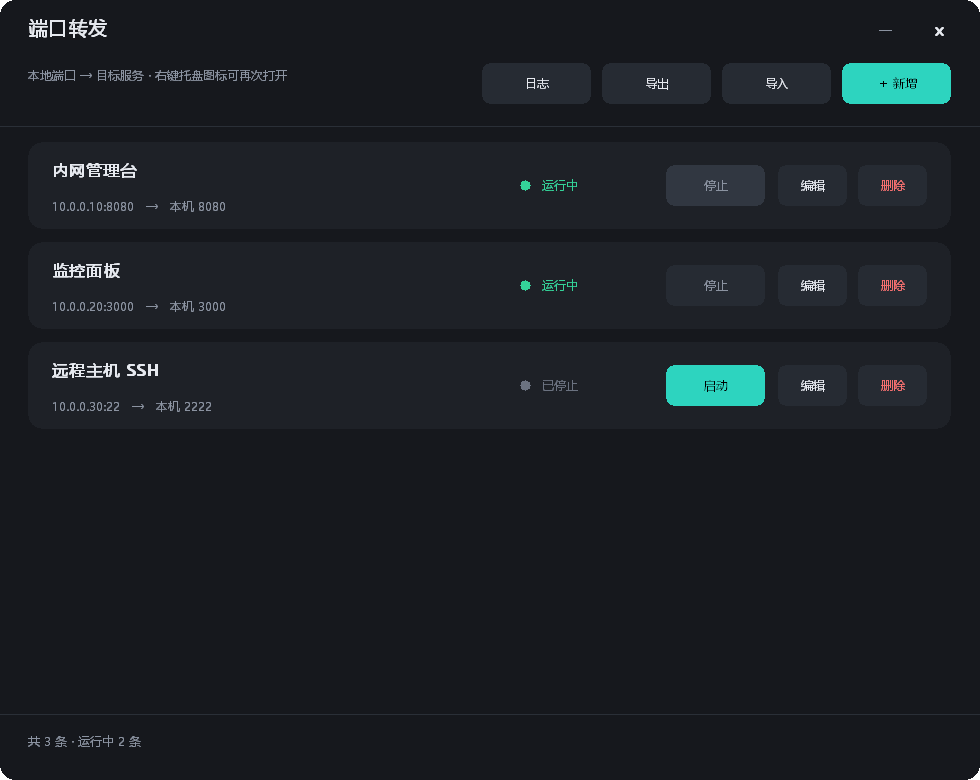
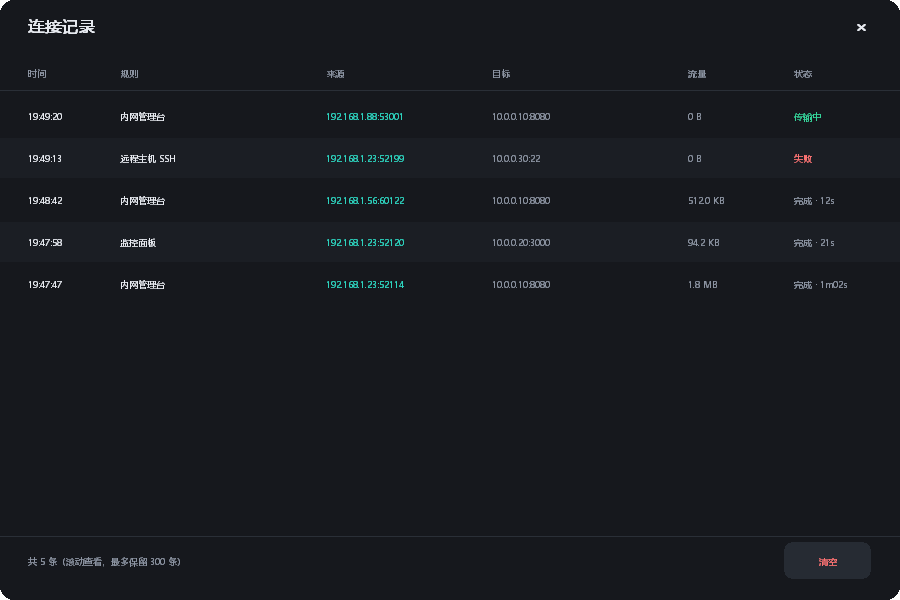

# PortFwd 使用说明

一个 Windows 托盘小程序，把「只有特定网段能访问的服务」搬到你本机的端口上，让别人用 `http://你的IP:端口` 就能访问。

典型场景：

- 你在办公网 / VPN 里能打开某个管理台，同事打不开 → 用本机做一次转发，把地址给他。
- 目标服务只允许白名单 IP 访问，而你恰好在白名单里。
- 不想给同事开 VPN 账号，只想临时放行一个页面。

不适用（要看清楚）：

- **没有身份认证**。转发口对所有能连到你机器的人开放，安全边界靠防火墙和网段控制，不靠 PortFwd。
- 只做裸 TCP 转发，不解析 HTTP。目标页面如果硬编码了绝对地址，可能出现「页面能开但数据不显示」，见文末 FAQ。

---

## 一、界面一览



从上到下：

| 区域 | 说明 |
|---|---|
| 标题栏 | 左边是名字，右上 `—` 最小化、`×` 关闭（关闭=收进托盘，不退出）。按住空白处可拖动窗口 |
| 工具行 | 左：一句提示；右：`日志` `导出` `导入` `＋ 新增` |
| 列表 | 一条规则一张卡片：名称、`目标地址:端口 → 本机 端口`、状态灯、`启动/停止` `编辑` `删除` |
| 底部 | 总数与运行数，右侧显示失败原因 |

状态灯：绿色 `运行中`、灰色 `已停止`、红色 `失败`（失败原因会显示在底部）。

---

## 二、第一次配置：五步

### 1. 启动

双击 `PortFwd.exe`，托盘出现图标，面板自动打开。

首次运行时列表是空的，会提示「还没有转发规则」。

### 2. 点「＋ 新增」

弹出对话框，四个输入框：

| 字段 | 填什么 | 例子 |
|---|---|---|
| 名称 | 随便起，方便自己认。留空则自动用 `地址:端口` | `内网管理台` |
| 目标地址 | 目标服务的 IP 或域名（**你这台机器能访问到的那个地址**） | `10.0.0.10` |
| 目标端口 | 目标服务监听的端口 | `8080` |
| 本地端口 | 对外提供的端口，别人连你机器时用这个。填一个本机没被占用的 | `8080` |

点「保存」。保存后**立即开始监听**，状态灯变绿。

> 本地端口不能和已有规则重复，重复会提示「本地端口 x 已被「某规则」占用」。

### 3. 放行防火墙（关键，很多人卡在这里）

程序监听 `0.0.0.0:本地端口`，但 **Windows 防火墙默认拦截入站**，不放行的话别人连不上。

管理员 PowerShell / 终端里执行（把 `8080` 换成你的本地端口）：

```powershell
New-NetFirewallRule -DisplayName "PortFwd-8080" -Direction Inbound -Protocol TCP `
  -LocalPort 8080 -Action Allow -Profile Any -RemoteAddress 192.168.1.0/24
```

`-RemoteAddress` 是**允许哪些网段连进来**，按需写小一点：

| 场景 | 建议范围 |
|---|---|
| 只给同办公室的人 | 你所在办公网段，如 `10.0.0.0/24` |
| 给公司内多个网段 | `10.0.0.0/8` |
| 只给自己本机测试 | `127.0.0.1` |

写完立即生效，不需要重启程序。

### 4. 找到自己的 IP 给同事

```powershell
Get-NetIPAddress -AddressFamily IPv4 | Where-Object { $_.IPAddress -notlike "127.*" } |
  Select-Object IPAddress, InterfaceAlias
```

挑同事能访问到的那张网卡，把 `地址:本地端口` 拼起来给他，例如 `http://192.168.1.100:8080`。

### 5. 验证

在你自己的机器上先试一次：

```powershell
curl.exe -s -o NUL -w "%{http_code}\n" http://127.0.0.1:8080/
```

返回 `200` 说明转发链路是通的；再让同事访问。他那边打不开，问题就只剩防火墙或网段两件事。

---

## 三、规则管理

| 操作 | 怎么做 |
|---|---|
| 启停单条 | 卡片右侧 `启动` / `停止`，会记住状态，下次启动程序按上次恢复 |
| 编辑 | 卡片右 `编辑`，改完保存会先停旧的再按新参数启动 |
| 删除 | 卡片右 `删除`，立即停止并移除（无二次确认） |
| 全部启停 | 托盘右键 → `全部启动` / `全部停止` |
| 滚动 | 规则多于 6 条时，鼠标滚轮翻页，底部会显示 `滚轮翻页 1/N` |

---

## 四、连接记录：看谁在用



点工具行 `日志` 打开，每条记录表示**一次 TCP 连接**：

| 列 | 含义 |
|---|---|
| 时间 | 连接建立时间 |
| 规则 | 命中的规则名 |
| 来源 | 对方的 `IP:端口`，这就是「谁进来了」 |
| 目标 | 实际连到的服务地址 |
| 流量 | 双向合计字节数 |
| 状态 | `传输中` / `完成 · 耗时` / `失败`（原因见底部提示） |

约定：

- 最多保留最近 **300 条**，超出自动丢最旧的。
- 记录**只存在内存**，程序退出即清空；不想留痕可随时点 `清空`。
- 窗口每秒刷新，新连接自动出现在最上面。

想判断「是不是有人在偷连」，看几个陌生 IP 反复出现就知道了。

---

## 五、导入导出

- `导出`：选个路径，把当前全部规则存成 `.json`。
- `导入`：选文件，**替换**当前全部规则（不是合并），并按文件里的 `enabled` 决定是否立即启动。

导出的文件长这样（地址已脱敏）：

```json
{
  "items": [
    {
      "id": "f1",
      "name": "内网管理台",
      "target_host": "10.0.0.10",
      "target_port": 8080,
      "local_port": 8080,
      "enabled": true
    }
  ]
}
```

`enabled` 是这条规则上次是否在运行；`id` 是内部标识，导入时留空会自动补。

---

## 六、托盘与开机自启

托盘图标右键菜单：

```
打开面板
──────
全部启动
全部停止
──────
退出
```

- **双击图标** = 打开面板。
- **点 × 或关闭按钮** = 只是隐藏面板，转发继续跑。
- **退出** = 停止全部转发并结束进程。

开机自启（静默进托盘，不弹面板）：把下面这条注册成登录时运行的计划任务即可。

```powershell
$exe = "C:\Apps\PortFwd\PortFwd.exe"
Register-ScheduledTask -TaskName "PortFwd" `
  -Action (New-ScheduledTaskAction -Execute $exe -Argument "--tray") `
  -Trigger (New-ScheduledTaskTrigger -AtLogOn -User "$env:USERDOMAIN\$env:USERNAME") `
  -Settings (New-ScheduledTaskSettingsSet -ExecutionTimeLimit ([TimeSpan]::Zero) -MultipleInstances IgnoreNew) `
  -Force
```

`--tray` 表示启动后直接进托盘、不弹面板。

---

## 七、配置文件在哪

```
%APPDATA%\PortFwd\config.json
```

即 `C:\Users\<你>\AppData\Roaming\PortFwd\config.json`。删除此文件 = 恢复空配置。

---

## 七之二、日志（排查用）

位置：

```
%APPDATA%\PortFwd\portfwd.log
```

托盘右键 → **打开日志** 可直接打开。每次启动追加一段，内容包括：

```
==== start PortFwd v1.0.3 (pid 17000) args=[--tray]
config loaded: 3 rules from C://Users//...//config.json
  rule "内网管理台" local=:8080 -> 10.0.0.10:8080 enabled=true
tray NIM_ADD ok=1 cbSize=976
[fwd] start ok rule="内网管理台" listen 0.0.0.0:8080 -> 10.0.0.10:8080
tray event lp=0x202
panel shown
[conn] open rule="内网管理台" from=192.168.1.23:52114 to=10.0.0.10:8080
[conn] close from=192.168.1.23:52114 to=10.0.0.10:8080 bytes=18432 dur=1.2s
```

覆盖：启动参数、配置加载结果、托盘注册结果、每条转发启停与失败原因、每次连接的来源/目标/字节/耗时。

滚动策略：单文件超过 **2 MB** 自动改名为 `portfwd.log.1`（只留一个备份）。

> 注意：日志里含真实内网 IP 与端口，发给别人前先清理。

## 八、命令行参数

| 参数 | 作用 |
|---|---|
| `--tray` / `--startup` | 启动后进托盘，不显示面板（开机自启推荐） |
| `--check` | 无界面自检：按配置启动所有规则，把监听结果写到 `%TEMP%\portfwd-check.txt` 后退出 |
| `--dump` | 把当前配置导出到 `%TEMP%\portfwd-dump.json` |
| `--selftest` | 起一条临时转发并真连一次，事件写入 `%TEMP%\portfwd-selftest.txt` |
| `--shot <文件.bmp>` | 渲染面板截图（界面回归用） |
| `--shot-log <文件.bmp>` | 渲染连接记录截图 |

---

## 九、常见问题

**Q：点「启动」后状态是红色「失败」，底部写 `bind: Only one usage of each socket address...`**
本地端口被别的程序占了。换一个本地端口，或先关掉占用者（`netstat -ano | findstr :8080` 查 PID）。

**Q：同事那边页面能打开，但数据加载不出来 / 一直转圈**
目标前端把接口地址写成了绝对地址（比如 `http://10.0.0.10:8080/api/...`），他的浏览器去连的是**原地址**，不是你的转发口。裸 TCP 转发改不了这个。解决办法：让对方能直连原地址，或者用能改写 Host/Origin 的反向代理（nginx / Caddy）代替裸转发。

**Q：只想自己用，不想给别人**
本地端口固定监听 `0.0.0.0`，用防火墙限制来源即可：

```powershell
New-NetFirewallRule -DisplayName "PortFwd-8080" -Direction Inbound -Protocol TCP `
  -LocalPort 8080 -Action Allow -RemoteAddress 127.0.0.1
```

**Q：关掉程序转发就停了？**
是的。想长期跑就配开机自启（见第六节），并让面板常驻托盘。

**Q：换了 exe 之后资源管理器还显示旧图标**
Windows 图标缓存。按 F5 刷新，或重启 `explorer.exe`。

**Q：能不能转发 UDP / 数据库连接？**
只支持 TCP。Oracle/MySQL 这类走 TCP 可以，UDP 服务（部分监控协议、游戏）不行。

---

## 十、从源码构建

需要 Go 1.22+，无 CGO、无第三方依赖：

```bash
# 1) 生成图标（仓库已带 icons/icon.ico，改了才需要重跑）
go run ./tools/icongen icons/icon.ico

# 2) 把图标嵌进 exe 资源（仓库已带 rsrc_windows_amd64.syso）
GOPATH=/tmp/go go install github.com/akavel/rsrc@v0.10.2
/tmp/go/bin/rsrc -ico icons/icon.ico -arch amd64 -o rsrc_windows_amd64.syso

# 3) 编译（无控制台窗口）
GOOS=windows GOARCH=amd64 CGO_ENABLED=0 \
  go build -trimpath -ldflags "-s -w -H windowsgui" -o PortFwd.exe .

# 调试版（带控制台，panic 可见）
GOOS=windows GOARCH=amd64 CGO_ENABLED=0 go build -trimpath -o PortFwd-debug.exe .
```

产物约 2.5 MB，复制到任意目录双击即可，不写注册表、不装服务。

---

## 十一、安全提醒

1. **转发口默认没有认证**。服务本身有登录页才有登录，没有就是裸奔。
2. 防火墙 `-RemoteAddress` 尽量写具体网段，别用 `Any`。
3. 用完就 `停止`，长期不用就删规则、删防火墙规则。
4. 连接记录能看到来源 IP，但**不落盘**，需要留痕要自己另做方案。
5. 不要把带真实内网地址的 `config.json` 或截图发到公开仓库。
